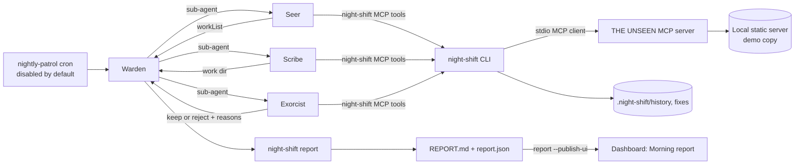

# Design: night-shift

## Overview

Night Shift has two layers.

1. **Core CLI** (`night-shift`, Node/TypeScript). Deterministic. It validates `patrol.yaml`, audits through THE UNSEEN, diffs, verifies fixes, and writes the report. It has no model calls and runs without Crew.
2. **Crew layer** (`app.json`, four agents, three skills, one cron, one dashboard page). The agents decide *what to edit*. Every judgement that can be made by code (what is new, whether a fix is safe, what the score change is) is made by the CLI, so the crew cannot misreport.



## Kiro Crew mechanism (as documented, 2026-11-25)

| Choice | Decision |
|---|---|
| Package | `app.json` at the repo root. No `crew.yaml`. |
| Handoff | The Warden is the lead and spawns subagents with the `kirocrew-core` tools `spawn` and `wait`; the subagent result is injected into the Warden's conversation. The delegation reason is `specialist`. |
| Schedule | Message cron only (`message` + `agent`). Command crons use `sh -c` and fail on this Windows host. |
| Backends | None. Exec backends are POSIX-only. |
| `platform` | Omitted, because the Windows value is not documented. |
| `permissions` | Only `permissions.api` is enforced, so only that key is ever written, and only when needed. |

**Why lead plus `spawn`/`wait` and not a Python workflow or the conductor.** The handoff here is a sequence with a loop (Scribe, Exorcist, maybe a second Scribe attempt) and the next step depends on the Exorcist's reasons, which the Warden relays in prose. Spawning subagents shows each handoff as a visible step in the lead's conversation, which is what the demo recording needs. A workflow script would need a runtime on the host (Python on Windows, unverified), and a conductor adds a coordinator the task does not need. The cost: the order of steps is enforced by the Warden's prompt and skill, not by code. The CLI mitigates this: it refuses unsafe states (existing work dir, unknown haunting id, missing history) and the report is built from the fix records the Exorcist's CLI call wrote, so a Warden that skips a step produces a report that says so under "Not attempted".

## Repo layout

```
app.json  patrol.yaml  README.md  LICENSE  package.json  tsconfig.json  vitest.config.ts
agents/        warden.json seer.json scribe.json exorcist.json
skills/        patrol/SKILL.md  draft-fix/SKILL.md  verify-fix/SKILL.md
src/
  cli.ts                 argument parsing, exit codes
  commands/              validate.ts audit.ts diff.ts verify.ts report.ts patrol.ts workdir.ts
  pure/                  schema.ts fingerprint.ts diff.ts decide.ts report.ts render-report.ts safety.ts slug.ts
  io/                    mcp-client.ts static-server.ts history.ts fs-atomic.ts copy-dir.ts
ui/            src/ (page.tsx, render.tsx, last-report.json) vite.config.ts dist/ (committed)
demo/          cursed-shop-copy/  bad-fix/  README.md   (work/ and cursed-shop-fixed/ ignored)
docs/sample-report/   REPORT.md report.json
tests/         unit, property, *.int.test.ts, arbitraries/
.kiro/         steering/{crew,product,tech}.md  specs/night-shift/  hooks/test-gate.json
```

## Core CLI

**Dependencies:** `zod`, `yaml`, `@modelcontextprotocol/sdk` (client), `vite`, `react`, `react-dom`, `lucide-react` (UI), `vitest`, `fast-check`, `typescript`, `@types/node`. `package.json` has `bin: { "night-shift": "dist/cli.js" }`, `type: module`.

**Pure and I/O are split.** Everything in `src/pure/` takes and returns plain data and is property tested. `src/io/` holds the only code that touches the network, disk or processes. Commands compose them.

### Audit engine boundary

```ts
type AuditPage = (url: string) => Promise<{ score: number; hauntings: RawHaunting[] } | { error: string }>
```

`io/mcp-client.ts` implements it with a stdio MCP client spawning `node $UNSEEN_MCP_SERVER_JS` and calling `audit_url { url, page: 'full' }`. The structured result is parsed with a Zod schema that tolerates extra fields. Tests inject a fake `AuditPage`. Decision: use the MCP server and not an import of `@the-unseen/core`, so Night Shift depends on the same public surface the agents use and needs no cross-repo build graph.

### Fingerprints

`pure/fingerprint.ts` re-implements the algorithm of `the-unseen/packages/mcp/src/pure/baseline.ts` (same key format and `#n` suffix). It is not imported: that file lives in another repo's workspace package and importing it would couple this repo's build to a sibling checkout for 10 lines. It is covered by its own properties (P1, P2).

### Diff

```ts
diffPatrols(prev: PageSet | undefined, curr: PageSet): { new: H[]; worsened: H[]; resolved: H[] }
```

Per page, build a map `fingerprint -> haunting`. New = in curr, not in prev. Worsened = in both, `rank(curr.severity) > rank(prev.severity)`. Resolved = in prev, not in curr. A page present only in `curr` counts all as new.

### Decision

```ts
decide(before: Page[], after: Page[], target: {page: string; fingerprint: string}): { decision: 'keep'|'reject'; reasons: Reason[] }
```

Rules in Requirement 5.2. The count rule: for each page and key `type|kind`, `count(after) > count(before)` is a new haunting. This is why the fingerprint of the *target* alone is compared, while *other* hauntings are compared by count: editing an element changes its snippet and therefore its fingerprint, and a fingerprint-only test would reject every fix on an element with a second problem. The cost is that a fix that removes one haunting of a key and adds another of the same key on another element is not caught. Accepted, and noted in the README.

`pure/safety.ts` implements the `unsafe-change` check on file text pairs (base vs fix): a new `<script` count, a new `position: fixed` with `z-index` in CSS or `style=`, and the extension allowlist.

### Verify flow

1. Read the site from `patrol.yaml`, resolve `base` (explicit, else `fixedDir` if it exists, else `source`).
2. Start two static servers (ports from `listen(0)`), audit the site's pages in each, always close servers in `finally`.
3. `safety` check on changed files, then `decide`.
4. Write the fix record atomically. Apply on keep with `--apply`. Exit 0, 3 or 1.

Attempt number is derived from the existing records for the same haunting id in this patrol.

### Report

`buildReport(histories, fixRecords, rescored)` is pure and returns the `report.json` object. `renderReport(report)` returns Markdown. The only I/O is re-auditing `fixedDir` for `scoreAfter`.

## The dashboard page: data source

**Choice: static import of `ui/src/last-report.json`, no backend.** The documented ways to get data to a page are an app API route or a backend. A backend can only be an exec backend, which is POSIX-only (this host is Windows), and I have not verified that a route without a backend can read repo files. A static import works everywhere, needs no permission, and keeps the page a pure function of a `report.json` for testing. The cost is a manual publish step (`night-shift report --publish-ui` then `npm run build:ui`), which the Warden's skill runs at the end of a patrol. If an app API route that serves a file is later confirmed, only `ui/src/load-report.ts` changes: it returns a `Report | undefined`, and the static import is its fallback.

**Rendering.** `ui/src/render.tsx` exports `ReportView({ report })`. It uses semantic HTML first (`main`, `h1`, `h2` per site, `table` with `caption` and `th scope`, `ul` for fixes) and uses `@kirocrew/app-sdk/ui` components only where the package's exports (checked at task time with the installed SDK) offer a layout wrapper. A decision label is text (`Kept`, `Rejected`) with an icon from `lucide-react` marked `aria-hidden` next to it. Reasons are rendered as text nodes. Vite builds `ui/dist/index.mjs` as a library with `formats: ['es']` and externals as in Requirement 11.2. If the SDK's page registration signature differs from what task 5 expects, the task records the actual signature in Notes and adapts `ui/src/index.tsx` only.

## Demo design

The copy is served by the CLI on a free port. Planted case: an icon-only focusable control that looks decorative (a sparkle or dot with `alt=""` image inside a link or button, no text). Its audit result is a Wraith `NamelessSpirit`. Two fixes:

- Obvious: `aria-hidden="true"` on the control. The control is still in the tab order, so THE UNSEEN reports a Veiled haunting; the count of `Veiled` rises, so `decide` rejects with `new-haunting`.
- Correct: `aria-label` on the control (or `tabindex="-1"` and `aria-hidden` together if it is truly decorative).

`demo/bad-fix/` stores the obvious fix so the rejection can be reproduced offline from a clean checkout and tested. In the live crew run the Scribe may or may not pick the obvious fix; the Exorcist's behaviour is the same either way, and the README says so.

## Correctness properties

Each is one `test()` with fast-check, at least 100 runs.

- **P1 Fingerprint independence:** for any list of hauntings, changing every node id, or any field other than `type`, `kind`, `htmlSnippet`, leaves the fingerprints unchanged.
- **P2 Fingerprint uniqueness:** fingerprints of one page are pairwise distinct, and identical keys get consecutive `#n`.
- **P3 Patrol schema round trip:** any generated valid patrol object, serialised to YAML and parsed by `validate`, is accepted and equal; for each rule in Requirement 2.4, a generated violating object is rejected with a path naming the offending key.
- **P4 Diff identity:** `diffPatrols(x, x)` has no new and no worsened hauntings.
- **P5 Diff completeness and order independence:** with `prev` empty, all hauntings are new; shuffling haunting order in either input does not change the result; `new`, `worsened` and `resolved` never share a fingerprint.
- **P6 Worsened rule:** a haunting present in both with equal or lower severity is never reported; with higher severity it is always reported once.
- **P7 Decision, target present:** if the target fingerprint is in `after`, the decision is `reject` with `target-still-present`, for any other content.
- **P8 Decision, new haunting:** if the target is gone and some `type|kind` count rose on any page, the decision is `reject` and the reason names that key; if the target is gone and no count rose, the decision is `keep` with no reasons. Adding hauntings to `before` never turns a keep into a reject.
- **P9 Safety check:** a fix that adds `<script`, an added `position: fixed` with `z-index`, or a file with a disallowed extension is rejected; a fix that only changes attribute values in HTML is not flagged.
- **P10 Report:** for any generated histories and fix records, `report.json` validates against its Zod schema, `scoreChange` equals `scoreAfter - scoreBefore` to one decimal, every kept or rejected fix record appears exactly once, and `renderReport` mentions every reason string and every site name. The dashboard `ReportView` rendered to static HTML contains one `h1`, a `caption` per table, and each reason string, for any generated report (including reasons containing `<` and `&`, which must be escaped).

Unit and example tests: `app.json` shape and cron; agent shape and role rules; skill front matter; the slug function; the `UNSEEN_MCP_SERVER_JS` default; CLI exit codes (`validate` 1, `patrol` without flag 2, `--open-prs` 2).

## Error handling

| Case | Behaviour |
|---|---|
| MCP server file missing | Exit 1, message names `UNSEEN_MCP_SERVER_JS` and the default path |
| A page fails to audit | Recorded with `error`; patrol continues; report lists it under the site |
| Unknown haunting id for `verify` | Exit 1, lists known ids from the history |
| Work dir exists | `workdir` refuses without `--attempt` |
| Corrupt history file | Ignored with a warning |
| Port or server start failure | Exit 1; servers closed in `finally` |

## Security

The CLI binds the static server to `127.0.0.1` only. It reads and writes only inside the repo (paths validated against `..` and absolute paths at schema level, and re-checked after resolving). It never runs a shell string built from `patrol.yaml` values; processes are started with argument arrays. It makes no outbound calls, pushes nothing, and creates no pull requests.

## Trade-offs recorded

- MCP client instead of importing Core: more moving parts at runtime, but one public surface.
- Count rule for new hauntings in `verify`: misses swap-type regressions, avoids false rejections.
- Static dashboard data: needs a publish step, works on Windows with no backend.
- Sequential fixes: slower overnight, but each fix verifies against the previous kept state.
