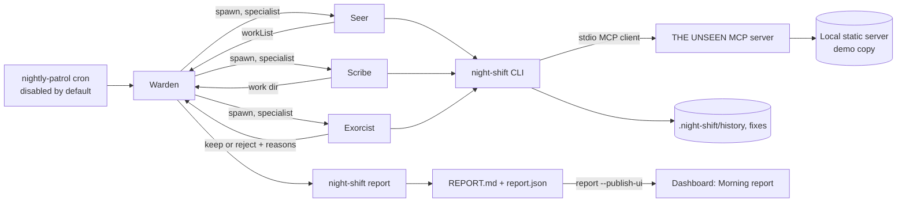

# Night Shift

A crew of four Kiro agents that patrols a list of websites overnight with [THE UNSEEN](../the-unseen) (an accessibility auditor exposed as an MCP server). In the morning it leaves accessibility fixes in a copy of the source and a report with the score change per site. It is an entry for the Best Kiro Crew App prize.

- **Deterministic core.** The `night-shift` CLI validates `patrol.yaml`, audits, diffs against the last patrol, verifies fixes and writes the report. It makes no model calls and runs without Crew.
- **Four agents decide what to edit.** The Warden leads. The Seer finds what is new. The Scribe drafts one minimal source fix. The Exorcist keeps or rejects it. Every judgement code can make (new, safe, score change) is made by the CLI, so the crew cannot misreport.
- **Nothing is pushed.** Kept fixes are applied to a local fixed directory. No git push, no pull requests. `--open-prs` is future work.

> Demo recording: _placeholder, to be added by the product lead_ (crew handoffs, the Exorcist rejection, the morning report).

## Architecture



| Agent | Job | Tools |
| --- | --- | --- |
| Warden (lead) | Validates `patrol.yaml`, spawns the others one step at a time (reason `specialist`), writes the morning report. Never edits source. | read, shell, `@kirocrew-core` |
| Seer | Runs `night-shift audit` and `night-shift diff` for one site and returns the `workList`: new or worsened Wraith and Restless hauntings only. | read, shell, `@unseen` |
| Scribe | Gets one haunting, makes a work directory copy, drafts a minimal source fix. Never adds an overlay or script, never hides a problem with `aria-hidden`. | read, write, shell, `@unseen` |
| Exorcist | Runs `night-shift verify`. Keeps the fix only if the haunting is gone and no new one appeared. Never edits source. | read, shell, `@unseen` |

After a reject the Warden gives the Scribe the Exorcist's reasons for one more attempt. The limit is 2 attempts per haunting. Fixes run one at a time so each starts from the previous kept fix.

## Setup

You need Node 22 or later, and THE UNSEEN built next to this repo: `../the-unseen` with `npm install` and `npm run build` done there, plus a Chromium for Playwright.

Night Shift talks to THE UNSEEN through its MCP server. The server file is read from the environment variable **`UNSEEN_MCP_SERVER_JS`**. The default is `../the-unseen/packages/mcp/dist/server.js`, relative to this repo's root. If the file is missing, every command that audits exits 1 and names the variable.

### Installing as a Crew app

The Crew app starts THE UNSEEN as `unseen-mcp` from your PATH. Crew does not expand shell-style `${VAR:-default}` placeholders and copies the app into its own folder, so a relative path to `../the-unseen` cannot work there. Run this once, in the THE UNSEEN checkout:

```
npm run unseen:install-global
unseen-mcp --help
```

Then `kirocrew app install <path to this repo>`. The `night-shift` CLI is separate and keeps its own lookup (`UNSEEN_MCP_SERVER_JS`, then the sibling path above).

For the CLI only, an alternative: install the package and point the variable at its server file. The `unseen-mcp` bin is a shim, and Night Shift starts the server with `node`, so use the real file:

```
npm install -g @the-unseen/mcp
# then point UNSEEN_MCP_SERVER_JS at <npm root -g>/@the-unseen/mcp/dist/server.js
```

### macOS and Linux

```bash
npm install
npm run build
export UNSEEN_CHROMIUM_CHANNEL=chromium          # or leave unset to use the default
export UNSEEN_MCP_SERVER_JS=../the-unseen/packages/mcp/dist/server.js   # optional, this is the default
node dist/cli.js validate
```

### Windows (PowerShell)

```powershell
npm install
npm run build
$env:UNSEEN_CHROMIUM_CHANNEL = 'chromium'
$env:UNSEEN_MCP_SERVER_JS = '..\the-unseen\packages\mcp\dist\server.js'   # optional, this is the default
node dist/cli.js validate
```

`npm link` (or `npm install -g .`) puts `night-shift` on your PATH. The examples below use `night-shift`; run `node dist/cli.js` if you did not link it.

### Install into Kiro Crew

```
kirocrew app install .
kirocrew app enable night-shift
```

Then ask the `warden` agent to run the patrol. `kirocrew agent validate ./agents` has not been run on the author's machine (Crew was not installed there). The agent, skill and manifest shapes are covered by structural tests in `tests/`. The Crew tool names and the `app.json` env default syntax are unverified against Crew itself.

## The patrol file

`patrol.yaml` lists the sites. The starter file patrols the demo copy:

```yaml
version: 1
maxFixesPerSite: 5
sites:
  - name: cursed-shop
    owner: demo-team
    serve:
      dir: demo/cursed-shop-copy      # served on a free local port
    source: demo/cursed-shop-copy      # the editable source
    fixedDir: demo/cursed-shop-fixed   # kept fixes are applied here
    pages: [/index.html, /product.html, /checkout.html]
```

A site has either `serve.dir` (with `source`) or `baseUrl`. `night-shift validate` prints one line per problem with its YAML path.

## Commands

| Command | What it does | Exit codes |
| --- | --- | --- |
| `night-shift validate [--file f]` | Checks `patrol.yaml`. | 0 ok, 1 problems |
| `night-shift audit [--site s] [--patrol-id id]` | Serves each site, audits every page, writes `.night-shift/history/<site>/<patrol-id>.json`. | 0, 1 |
| `night-shift diff --site s [--json]` | New, worsened and resolved hauntings against the previous patrol, and the `workList`. | 0, 1 |
| `night-shift workdir <site> <haunting-id> --patrol-id id [--attempt n]` | Copies the base directory to `demo/work/<patrol-id>/<haunting-id>`. Refuses an existing path. | 0, 1 |
| `night-shift verify <site> <fixDir> --haunting id [--base dir] [--apply]` | Audits base and fix, keeps or rejects, writes a fix record. `--apply` copies kept files into `fixedDir`. | 0 keep, 3 reject, 1 error |
| `night-shift report [--patrol-id id] [--publish-ui]` | Writes `REPORT.md` and `report.json`. | 0, 1 |
| `night-shift patrol --no-agents` | `validate`, `audit`, `diff` and `report` with no fixes. | 0 completed, 1 error |

`night-shift patrol` without `--no-agents` prints how to start the Warden and exits 2. `--open-prs` exits 2 (future work).

A fix is rejected with `target-still-present` (the haunting is still there or the page failed to audit), `new-haunting` (a `type|kind` count rose on any page) or `unsafe-change` (a file type other than html, css, js, svg or json, an added `<script>`, or an added `position: fixed` with a `z-index`).

## Demo

```
npm run build
night-shift patrol --no-agents        # audit the served copy, write REPORT.md
npm run demo:reject                   # a real rejection
```

The demo copy of the Cursed Shop has one planted case: a decorative-looking, focusable sparkle button with no accessible name (a Wraith Nameless Spirit). The obvious fix, `aria-hidden="true"` on the button, leaves it in the tab order and creates a new **Veiled** haunting, so `night-shift verify` rejects it. Giving the button an `aria-label` is kept. See [demo/README.md](demo/README.md).

**`demo/bad-fix/` is a recorded attempt, not an agent run.** It holds the obvious fix, written by hand as a Scribe-style change, so the rejection can be reproduced offline. The rejection itself is real: `npm run demo:reject` runs `night-shift verify` against the served copy with the real THE UNSEEN server and prints the reason. In a live Crew run the Scribe may or may not pick this fix; the Exorcist behaves the same either way. The kept fix in `tests/fixtures/correct-fix/` is a recorded attempt too, and the sample report below was produced without agents.

### Sample morning report

From `docs/sample-report/` (a patrol with one rejection and one kept fix, both recorded attempts):

````markdown
# Night Shift morning report: patrol 20261125T154231Z

Generated 2026-11-25T15:48:35.382Z. Lower scores are better.

## cursed-shop (owner: demo-team)

| Score before | Score after | Change |
| --- | --- | --- |
| 84.3 | 84.3 | 0.0 |

New hauntings: 91. Worsened: 0. Resolved: 0.

### Kept fixes

- `index-html-NamelessSpirit-d3eefb7e`: NamelessSpirit (Wraith) on /index.html, 2 attempts. **Recorded attempt, not an agent run.** Changed: index.html.

### Rejected fixes

- `index-html-NamelessSpirit-d3eefb7e`: attempt 1 was rejected, then a later attempt was kept. **Recorded attempt, not an agent run.**
  - Reason: new-haunting: TheVeiled on /index.html, 1 before and 2 after: <button type="button" class="sparkle-link subscribe-sparkle" aria-hidden="true" onclick="document.getElementById('products').scrollIntoView()"></button>

### Not attempted

- `index-html-NamelessSpirit-dbf2d295`: NamelessSpirit (Restless) on /index.html. beyond maxFixesPerSite (5).
- `index-html-NamelessSpirit-09f1cb78`: NamelessSpirit (Restless) on /index.html. beyond maxFixesPerSite (5).
- `index-html-NamelessSpirit-478bb10d`: NamelessSpirit (Restless) on /index.html. beyond maxFixesPerSite (5).
- `index-html-NamelessSpirit-4e0a940f`: NamelessSpirit (Wraith) on /index.html. in the work list, no fix record.
- `index-html-NamelessSpirit-46b7439f`: NamelessSpirit (Wraith) on /index.html. in the work list, no fix record.
- `index-html-NamelessSpirit-3f8d23a7`: NamelessSpirit (Wraith) on /index.html. in the work list, no fix record.
- `index-html-NamelessSpirit-dbba5d8a`: NamelessSpirit (Wraith) on /index.html. in the work list, no fix record.
- `index-html-NamelessSpirit-ce7af3f9`: NamelessSpirit (Wraith) on /index.html. beyond maxFixesPerSite (5).
- `index-html-NamelessSpirit-f437cf3b`: NamelessSpirit (Wraith) on /index.html. beyond maxFixesPerSite (5).
- `index-html-LostSoul-6f195bbc`: LostSoul (Restless) on /index.html. beyond maxFixesPerSite (5).
- ...and 80 more, listed in report.json.
````

The Haunting Score is weighted by type and capped, so removing one Nameless Spirit among many does not always move a page's score, as here. The dashboard page "Morning report" shows the same data: run `night-shift report --publish-ui` then `npm run build:ui`. It reads `ui/src/last-report.json` and has no backend.

## Nightly schedule

`app.json` declares one message cron, `nightly-patrol`, at `0 2 * * *` for the `warden` agent, with `enabled: false`. **Nothing runs overnight until you enable it.** To turn it on, set `"enabled": true` on that entry in `app.json` and reinstall the app with `kirocrew app install .`, or enable the cron from Crew itself, then check that Crew lists `nightly-patrol` as enabled. The exact Crew command for enabling a single cron was not checked on the author's machine. Crew command crons run through `sh -c` and fail on Windows, so this is a message cron: it sends the text "Run the Night Shift patrol from patrol.yaml and write the morning report." to the Warden.

## Tests

```
npm test                   # unit and property tests (fast-check, at least 100 runs each)
npm run test:integration   # real THE UNSEEN server: patrol against the demo copy, verify, dashboard audit
npm run typecheck
```

The integration tests need `UNSEEN_MCP_SERVER_JS` (or the sibling default) and, on Windows, `UNSEEN_CHROMIUM_CHANNEL=chromium`. They skip with a message when the server file does not resolve, and fail if the variable is set to a missing file.

## Known limits

- `verify` compares every haunting other than the target by `type|kind` count per page. A fix that removes one haunting of a type and adds another of the same type on a different element is not caught. A fingerprint-only comparison would reject every fix on an element with a second problem, because editing the target changes its snippet.
- Automated checks find roughly 30 to 40 percent of WCAG issues. A clean report does not mean a site meets a standard.
- Fixes are sequential, which is slower overnight but lets each fix verify against the previous kept state.

## Future work

- `--open-prs`: open pull requests for kept fixes. Not implemented; no code in this repo pushes to a remote or creates a pull request.
- An app API route for the dashboard, if one that serves a file is confirmed, replacing the static `last-report.json`.

## License

MIT. See [LICENSE](LICENSE).